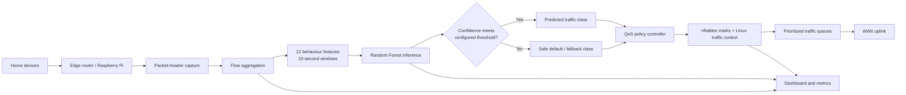

EdgeQoS-AI
A Confidence-Gated Learning Framework for Encrypted Traffic Prioritization and Adaptive QoS Enforcement

  
  
  
  
  
  

  <b>Poneglyph Parsers</b> 
  Rithish PK · Chinmay Deepak Chandavar 
  NMIT Bengaluru · Tata Elxsi Teliport Season 4 · Case Study 3

Overview
EdgeQoS-AI is an edge-based Quality of Service (QoS) prototype for mixed home-broadband traffic. It observes packet-header metadata, extracts flow-level behaviour features, uses a Random Forest classifier to estimate traffic behaviour, and maps sufficiently confident predictions to Linux traffic-control policies.

The prototype is designed for environments where different applications share a constrained home internet connection. In the demonstrated two-class home experiment, the system distinguishes gaming-like traffic from bulk-download traffic and prioritizes latency-sensitive traffic while allowing bulk transfers to use available capacity.
Privacy design: the documented capture path uses packet-header/flow metadata rather than application payload inspection. Traffic metadata can still reveal behavioural information; use only networks and devices for which you have authorization.

At a glance
Area	Current project implementation
Edge platform	Raspberry Pi 4 router prototype
Traffic observation	Linux packet capture and flow aggregation
Feature extraction	12 flow size, timing and direction features; 10-second windows, as documented in the project experiment
Classifier	Random Forest; home-training utility defaults to 64 trees
Confidence handling	Configurable confidence threshold; documented example uses 0.70
Enforcement	Linux traffic control with nftables packet marking and queueing disciplines
Dashboard	Browser-based live dashboard in web/index.html
Demonstrated home labels	Gaming and bulk traffic
Additional label schema	Streaming, interactive, bulk, realtime and gaming are defined in the home-training utility; broader classes require suitable labelled captures and validation

System architecture

Processing pipeline
1. Capture: observe packet and flow metadata at the edge router.
2. Feature extraction: summarize packet sizes, rates, timing and traffic direction into flow windows.
3. Classification: run the Random Forest on extracted features.
4. Confidence gate: use a prediction for policy selection only when it satisfies the configured confidence threshold; otherwise retain the fallback/default treatment.
5. Enforcement: map policy classes to packet marks and Linux traffic-control queues.
6. Monitoring: expose observed flows, predicted behaviour and network metrics through the dashboard.
QoS policy concept
The project documentation describes four traffic classes:
Class	Intended treatment
Realtime	Highest priority for latency-sensitive traffic
Interactive	High priority for interactive applications
Best effort	Default treatment for ordinary traffic
Bulk	Lower-priority/background transfers; uses remaining capacity

The documented policy uses nftables for packet marking and Linux traffic control for queueing. HTB and FQ-CoDel are described in the project architecture; the exact scheduler and enabled features depend on the runtime configuration. Do not assume every scheduler or automatic capacity feature is enabled in every deployment.
Demonstrated prototype
The team has demonstrated a Raspberry Pi-based setup connected to home devices, with a browser dashboard showing device bandwidth consumption and predicted traffic behaviour.

The current documented home experiment focuses on gaming and bulk downloads. The project includes code paths for capacity estimation, temporary intent handling and policy control; the availability of a module does not by itself mean that the feature was enabled in the reported demo configuration.
Experimental results
The following values are transcribed from the project's supplied docs/RESULTS.md. They are team-reported measurements, not independently reproduced by this README.
Latency under concurrent download load
Test condition	Reported result
No QoS	366 ms p95; 484 ms p99; 33% probe loss
EdgeQoS enabled	18–30 ms p95
Three-device oversubscribed scenario	25–32 ms average; 41–55 ms peak

The documented setup was a Raspberry Pi 4 (8 GB), 5 GHz hotspot, Ethernet uplink, with shaping caps of 40 Mb/s downlink and 12 Mb/s uplink. The workload paired an online game on a phone with a speed test or large download on a laptop; the three-device scenario added 4K video and multi-stream download traffic.
Classification comparison
Classifier	Game → realtime	Download → bulk	Confident enough to act
Port-rule baseline	0%	0%	—
Random Forest trained on public datasets	2–3%	0%	1.2% of flows
Home-trained Random Forest	90–97%	95%	84–96%

The project results document states that 62% of game traffic and all download traffic used port 443 in the tested setup, limiting the usefulness of port-only rules. It also reports that none of 618 traffic windows above 5 Mb/s was assigned to the game class.

Interpretation note: classification accuracy and confidence coverage are different metrics. The reported 90–97% and 95% class results should be read alongside the 84–96% confident-coverage figure and the original experiment methodology. These figures should not be collapsed into one overall accuracy number.

The public repository currently contains the core implementation, dashboard, router utility, tools and public baseline model. Detailed raw experiment logs, benchmark plots and the private home-labelled captures are not part of this published source snapshot. Add only reviewed, anonymized evidence files, and keep each chart with its test conditions and metric definitions.
Repository structure
The published repository is organized as follows:
<pre>
EdgeQoS-AI-TataElxsi/
├── edgeqos/     Core Python modules: capture, flow processing, model, policy and service
├── web/         Browser-based dashboard
├── router/      Router and uplink utility
├── tools/       Capture, training and benchmark scripts
├── models/      Public-data baseline model artifact
├── README.md    Project overview and documentation
└── .gitignore   Excludes local and generated files
</pre>
Local network configuration, credentials, device-specific identifiers and labelled home captures are intentionally excluded from the public repository.
Getting started
Requirements
The runtime is designed for a Linux-based edge router. The router-side components interact with Linux networking facilities, including packet capture, nftables, tc and (for the supplied router reconciliation script) NetworkManager. Administrative privileges are required for network capture and traffic-control changes.
- Python 3
- Linux environment with the networking utilities required by the selected policy backend
- Raspberry Pi 4 or a compatible Linux test environment
- A locally prepared configuration file appropriate to your interfaces and network
The project snapshot does not include a dependency lockfile or a complete installation script. Verify the Python and operating-system requirements on the target device before deployment.
1. Clone the repository
git clone https://github.com/RithishPK/EdgeQoS-AI-TataElxsi.git
cd EdgeQoS-AI-TataElxsi
2. Prepare a local configuration
Create a local configuration file based on your own router interfaces, uplink, downlink, shaping rates, model path and authorized control clients. Do not commit real device identifiers, hotspot names, private network details or credentials.

The service CLI accepts a configuration path and exposes these actions:
python3 -m edgeqos --config /path/to/local-config.json preflight
python3 -m edgeqos --config /path/to/local-config.json plan
python3 -m edgeqos --config /path/to/local-config.json benchmark
python3 -m edgeqos --config /path/to/local-config.json run
preflight checks the environment; plan prints the policy plan; benchmark reports model benchmark information; run starts the service. Review the code and test in a controlled environment before enabling enforcement on a live network.
3. Train a home-specific model
The included training utility reads labelled JSONL capture files and writes a model artifact. Example command (replace the input paths with your own authorized, anonymized captures):
python3 tools/train_home_model.py /path/to/labelled-capture-1.jsonl /path/to/labelled-capture-2.jsonl -o models/home-behavior-forest.json
The training utility defaults to 64 trees and depth 10. The supplied home-capture files are not included in this public repository; collect and label your own traffic before attempting home-specific training.
4. Roll back policy changes
The service provides a rollback action. Use the same local configuration path used to start the service:
python3 -m edgeqos --config /path/to/local-config.json rollback
Understand the policy ownership and rollback behaviour before running commands with elevated privileges.
Safety, privacy and responsible use
- Use this software only on networks and devices you own or are explicitly authorized to administer.
- Do not inspect or collect application payloads; the intended classifier input is flow metadata.
- Treat flow metadata and traffic labels as potentially sensitive.
- Keep local configuration, credentials, device identifiers and raw captures out of public commits.
- Begin in monitor/preflight mode and validate the policy plan before enabling enforcement.
- Keep a recovery path to restore the router's original connectivity and QoS state.
- Do not deploy experimental traffic policies on networks where disruption could affect critical services.
Current scope and limitations
- The documented home evaluation focuses on gaming-versus-bulk traffic; it does not establish validated recognition of every application.
- Results are from the team's stated test environment and should not be generalized to all routers, ISPs, devices or traffic mixes.
- The public repository snapshot does not include the private labelled home-capture dataset or a full dependency/installation manifest.
- The code includes a capacity-estimation module, but automatic capacity control is configuration-dependent. The supplied experiment documentation does not establish that automatic capacity adaptation was enabled in the reported demo.
- Additional streaming and video-call classes require labelled captures, retraining and separate evaluation.
- Dashboard predictions are experimental flow-behaviour classifications, not guaranteed application identity.
Team
Poneglyph Parsers
Rithish PK · Chinmay Deepak Chandavar
Nitte Meenakshi Institute of Technology (NMIT), Bengaluru
Tata Elxsi Teliport Season 4 · Case Study 3
Acknowledgement
This project was developed for the Tata Elxsi Teliport Season 4 hackathon case study. Dataset and third-party component attribution should be maintained in the relevant source files and documentation.

  <b>EdgeQoS-AI</b> · Learning from traffic behaviour. Prioritizing what matters.

